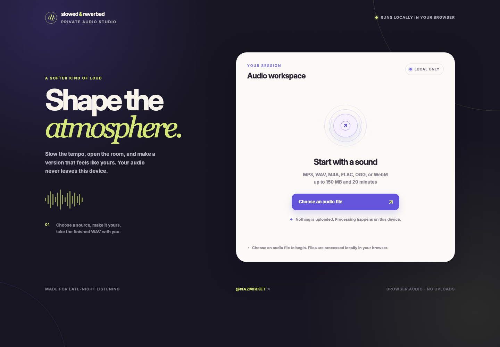

# Slowed & Reverbed

**Slow a track, add reverb, and export a WAV—all in your browser.**

A browser-based audio studio built with Nuxt and Tone.js. Choose an audio file,
adjust the sound, preview it, and download the processed track. Audio decoding,
effects, and export run locally; selected files are not uploaded.

[Open the audio studio](https://sr.mirket.dev/) · [Local development](#local-development) · [Deployment](#container-deployment) · [Report an issue](https://github.com/nazmirket/slowed-reverbed/issues)

[](https://sr.mirket.dev/)

## Make a track

1. Choose an audio file from your device.
2. Set the slowdown amount and reverb level.
3. Preview the sound and adjust the controls.
4. Render and download the result as a WAV file.

Slowing playback also lowers pitch. The render includes the reverb tail so the
effect can fade out after the track ends.

| Control or limit | Supported range |
| --- | --- |
| Slowdown | 5–60% (15% by default) |
| Reverb | 1–10 (3 by default) |
| Input file size | Up to 150 MiB |
| Input duration | Up to 20 minutes |
| Export | WAV |

Supported input formats depend on your browser's audio decoder. Common choices
include MP3, WAV, M4A, OGG, and FLAC. Decoded audio and the rendered output use
memory, so large tracks may exceed the resources available on smaller devices.
The site still makes normal network requests to load its code and assets;
local audio processing does not imply offline availability.

## Local development

Use **Node.js 22–24** and **pnpm 10.33.0**.

```sh
git clone https://github.com/nazmirket/slowed-reverbed.git
cd slowed-reverbed
corepack enable
pnpm install --frozen-lockfile
pnpm dev
```

Open the local URL printed by Nuxt, usually `http://localhost:9333`.
No database, API service, or account credentials are required to process audio.

## Project structure

| Path | Responsibility |
| --- | --- |
| `pages/index.vue` | File selection, playback, effect controls, rendering, and download |
| `utils/audio.ts` | Audio limits, validation, playback rates, and output duration |
| `utils/audio.test.ts` | Regression tests for the audio utilities |
| `public/` | Static assets and site metadata |
| `docker/nginx.conf` | Static hosting and health endpoint |

The app uses Nuxt, Vue, TypeScript, Tailwind CSS, Tone.js, and
`audiobuffer-to-wav`. Nuxt generates a static site; audio processing uses the
browser's Web Audio capabilities.

## Verify and build

```sh
pnpm check
pnpm audit
pnpm generate
```

`pnpm check` runs lint, type checks, and unit tests. `pnpm generate` writes the
static site to `.output/public/`, ready for a static host. For audio or interface
changes, also test file selection, preview, rendering, download, and error
recovery in a real browser.

## Container deployment

Use **Podman with a Compose provider**. The multi-stage image runs the application
checks and static generation, then serves the output with unprivileged Nginx.

```sh
podman compose up --build -d
podman compose ps
curl --fail http://127.0.0.1:9333/healthz
```

The service binds to loopback at `127.0.0.1:9333` for use behind a reverse proxy.
Set `APP_PORT` to choose another host port:

```sh
APP_PORT=9334 podman compose up --build -d
```

To update a deployment, build from the intended source revision and recreate the
app service:

```sh
podman compose build
podman compose up --no-deps -d app
curl --fail http://127.0.0.1:9333/healthz
```

Use `podman compose down` to stop the service. See [compose.yaml](compose.yaml)
for the image tag, health check, read-only filesystem, and port configuration.

## Contributing

Report reproducible bugs or suggest improvements through
[GitHub Issues](https://github.com/nazmirket/slowed-reverbed/issues). Include your
browser, input format, track duration, and the steps that reproduce the issue.

[AGENTS.md](AGENTS.md) documents the Mirket workflow for Codex Desktop and Claude
Desktop Code. Run `pnpm agents:check` alongside the application checks when
working with an agent.
